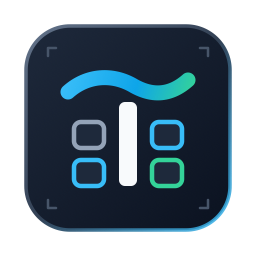

<div align="center">



# tidalto-plugins

**TidaltoLabs 官方多宿主 Agent 插件市场**

[](#插件目录)
[](https://agent-plugins.org/schemas/1.0.0/plugin.schema.json)
[](https://antigravity.google/schemas/v1/plugin.json)
[](LICENSE)

简体中文 · [English](README_EN.md) &nbsp;|&nbsp; [插件目录](#插件目录) · [安装方式](#安装方式) · [仓库结构](#仓库结构) · [参与贡献](AGENTS.md)

</div>

---

本仓库是 **TidaltoLabs** 维护的统一 Agent 插件市场（原 `TidaltoLabs/eng-system` 单插件仓库升级而来）。每个插件只维护一份内容源，由构建脚本生成各宿主可直接识别的独立插件包，并通过仓库根目录的市场清单统一分发。

---

## 插件目录

| 插件 | 版本 | 简介 | 技能数 | Claude Code | Codex / Cursor / Copilot | Antigravity | ZCode | DSH | 文档 |
|---|---:|---|---:|:---:|:---:|:---:|:---:|:---:|---|
| **[eng-system](packages/eng-system/README.md)** | `0.3.4` | 工程文档体系技能组：接手导览、骨架引导、调研协议、决策记录、架构规格、里程碑规划与验收、一致性审查 | 7 | ✅ | ✅ | ✅ | ✅ | ✅ | [中文](packages/eng-system/README.md) · [EN](packages/eng-system/README_EN.md) |
| **[brand-kit-maker](packages/brand-kit-maker/README.md)** | `0.1.2` | 品牌制作套件：从品牌需求与设计讨论出发，定稿 Logo、配色、文案与字体，并导出完整站点品牌套件 | 1 | ✅ | ✅ | — | — | — | [中文](packages/brand-kit-maker/README.md) · [EN](packages/brand-kit-maker/README_EN.md) |

> **为什么 `brand-kit-maker` 目前仅开放给 Claude Code 与 Codex？**
> 该插件的设计讨论阶段依赖宿主会话原生的图像生成与看图评审能力，目前优先承接给默认具备生图能力的 Claude Code 与 Codex；导出脚本基于 Windows PowerShell 7。后续视其他宿主的生图能力与跨平台导出脚本完善后再扩展。

---

## 安装方式

本仓库既是**插件市场**（marketplace），也是**构建产物仓库**。各宿主按下方方式接入后即可按需选择安装其中的插件。

### Claude Code

```bash
# 1. 添加本市场（会话内用 /plugin ... 同样可用）
claude plugin marketplace add TidaltoLabs/tidalto-plugins

# 2. 按需安装插件
claude plugin install eng-system@tidalto-plugins
claude plugin install brand-kit-maker@tidalto-plugins
```

### Codex CLI（Agent Plugins 1.0）

```bash
# 1. 添加本市场
codex plugin marketplace add TidaltoLabs/tidalto-plugins

# 2. 按需安装插件
codex plugin add eng-system@tidalto-plugins
codex plugin add brand-kit-maker@tidalto-plugins
```

### Cursor / GitHub Copilot

在各自插件面板中添加本 GitHub 仓库（识别 `.agents/plugins/marketplace.json`），按需启用 `eng-system` 或 `brand-kit-maker`。

### Google Antigravity（`agy`）

Antigravity 目前通过 GitHub 子目录 URL 安装（安装后 App / CLI / IDE 自动同步；升级只需重跑同一条命令，保留启用/禁用状态）：

```bash
agy plugin install https://github.com/TidaltoLabs/tidalto-plugins/tree/main/plugins/eng-system/antigravity
```

> **注意**：请务必传入具体插件的子目录 URL，不要直接传仓库根 URL，避免触发 `agy` 对 `plugins/` 的批量扫描。

### ZCode

在 ZCode UI 中打开：**插件市场 → 添加 → 添加插件市场**，填写 `TidaltoLabs/tidalto-plugins`，随后在列表中选择安装 `eng-system`（ZCode 无 CLI 入口；当同仓存在 `.claude-plugin/marketplace.json` 时 ZCode 优先读取该清单）。

### DSH（DeepSeek Harness）

```bash
# 从 GitHub 安装 eng-system bundle（市场收录前建议固定 commit 或分支）
dsh plugin --profile web add "git+https://github.com/TidaltoLabs/tidalto-plugins.git#main&path:plugins/eng-system/dsh"
```

零安装用法见 [packages/eng-system/adapters/dsh/README.md](packages/eng-system/adapters/dsh/README.md)。

---

## 宿主清单与更新机制

| 市场清单 | 适用宿主 | 指向产物 | 更新机制 |
|---|---|---|---|
| `.claude-plugin/marketplace.json` | Claude Code（ZCode 优先兼容） | `plugins/<plugin>/claude/` | SemVer（随各插件 `VERSION` 升号） |
| `.agents/plugins/marketplace.json` | Codex CLI / Cursor / Copilot | `plugins/<plugin>/agent-plugins/` | SemVer（随各插件 `VERSION` 升号） |
| `marketplace.json` | ZCode 根清单 / 官方市场格式 | `plugins/<plugin>/zcode/` | SemVer（随各插件 `VERSION` 升号） |
| 子目录直装 | Antigravity / DSH | `plugins/<plugin>/antigravity/`、`dsh/` | Antigravity 重跑 `install` 覆盖升级；DSH 随 git ref / bundle 版本 |

---

## 仓库结构

```text
tidalto-plugins/
├── README.md                          # 中文总览（本文件）
├── README_EN.md                       # 英文总览
├── AGENTS.md                          # 贡献者与技能写作规约
├── CHANGELOG.md                       # 市场级变更记录
├── LICENSE                            # MIT
├── logos/                             # 市场总览 Logo（logo.svg + 512/256/128 透明底 PNG）
├── .claude-plugin/marketplace.json    # Claude Code（及 ZCode 优先）市场清单
├── .agents/plugins/marketplace.json   # Codex / Cursor / Copilot 市场清单
├── marketplace.json                   # ZCode 根市场清单
├── packages/                          # 唯一手写源（每个插件一个独立目录）
│   ├── eng-system/                    # v0.3.4：7 技能 + 13 模板 + logos + 5 宿主适配
│   │   ├── VERSION
│   │   ├── CHANGELOG.md
│   │   ├── README.md / README_EN.md
│   │   ├── skills/
│   │   ├── templates/
│   │   ├── logos/
│   │   └── adapters/
│   └── brand-kit-maker/               # v0.1.2：品牌套件技能 + 模板 + 脚本 + 字体 + 案例 + logos + 2 宿主适配
│       ├── VERSION
│       ├── README.md / README_EN.md
│       ├── skills/
│       ├── templates/
│       ├── scripts/
│       ├── assets/
│       ├── examples/
│       └── adapters/
├── plugins/                           # 构建产物（入库，由 scripts/build.sh 生成，勿手改）
│   ├── eng-system/{agent-plugins,antigravity,claude,zcode,dsh}/
│   └── brand-kit-maker/{agent-plugins,claude}/
└── scripts/
    └── build.sh                       # 全量自检 + 多插件构建脚本
```

### 设计原则

1. **内容只有一份**：所有手写技能、模板、脚本、素材只维护在 `packages/<plugin>/` 下；`plugins/` 全部由 `./scripts/build.sh` 生成，且产物 README 顶部带「构建产物勿手改」横幅。
2. **内容与适配分离**：每个插件的 `adapters/<host>/` 只放对应宿主的清单与薄适配壳，不放技能正文或模板。
3. **按插件独立版本**：每个插件维护自己的 `packages/<plugin>/VERSION`，构建脚本自动校验所有适配清单与市场条目版本一致。

---

## 本地校验与构建

```bash
# 仅跑内容、规范与清单一致性自检
./scripts/build.sh check

# 自检并全量构建 plugins/<plugin>/<host>/（本机装有 agy 时自动跑 agy plugin validate --strict）
./scripts/build.sh
```

新增插件与贡献细则请先阅读 [AGENTS.md](AGENTS.md)。

---

License: [MIT](LICENSE)（各插件随附第三方字体等素材保留其原有开源协议，如 `brand-kit-maker` 附带字体的 [OFL](packages/brand-kit-maker/assets/fonts/OFL.txt)）。
