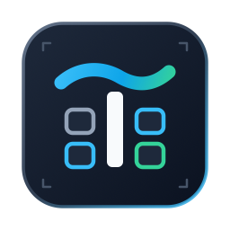

<div align="center">



# tidalto-plugins

**TidaltoLabs Official Multi-Host Agent Plugin Marketplace**

[](#plugin-catalog)
[](https://agent-plugins.org/schemas/1.0.0/plugin.schema.json)
[](https://antigravity.google/schemas/v1/plugin.json)
[](LICENSE)

[简体中文](README.md) · English &nbsp;|&nbsp; [Plugin Catalog](#plugin-catalog) · [Installation](#installation) · [Repository Layout](#repository-layout) · [Contributing](AGENTS.md)

</div>

---

This repository is the official **TidaltoLabs** Agent Plugin Marketplace (evolved from the single-plugin `TidaltoLabs/eng-system` repository). Every plugin keeps a single hand-written source under `packages/<plugin>/`, builds clean per-host bundles under `plugins/<plugin>/<host>/`, and is distributed through the root marketplace manifests.

---

## Plugin Catalog

| Plugin | Version | Summary | Skills | Claude Code | Codex / Cursor / Copilot | Antigravity | ZCode | DSH | Docs |
|---|---:|---|---:|:---:|:---:|:---:|:---:|:---:|---|
| **[eng-system](packages/eng-system/README_EN.md)** | `0.3.4` | Engineering documentation skill suite: onboarding, skeleton bootstrap, research protocol, ADRs, architecture specs, milestones & acceptance, consistency audits | 7 | ✅ | ✅ | ✅ | ✅ | ✅ | [EN](packages/eng-system/README_EN.md) · [中文](packages/eng-system/README.md) |
| **[brand-kit-maker](packages/brand-kit-maker/README_EN.md)** | `0.1.1` | Interactive brand discovery & sign-off workflow for logo, palette, copy, and typography, with PowerShell brand-kit export | 1 | ✅ | ✅ | — | — | — | [EN](packages/brand-kit-maker/README_EN.md) · [中文](packages/brand-kit-maker/README.md) |

> **Why is `brand-kit-maker` currently scoped to Claude Code & Codex?**
> Its interactive design phase relies on native image generation and visual proof review inside the host session, so it currently targets Claude Code and Codex. Its export scripts run on Windows PowerShell 7. Support for additional hosts may be added later.

---

## Installation

This repository acts as both the **marketplace source** and the **built plugin distribution**. Add the marketplace once in your host and install the plugins you need.

### Claude Code

```bash
# 1. Add this marketplace (/plugin ... also works inside a session)
claude plugin marketplace add TidaltoLabs/tidalto-plugins

# 2. Install plugins on demand
claude plugin install eng-system@tidalto-plugins
claude plugin install brand-kit-maker@tidalto-plugins
```

### Codex CLI (Agent Plugins 1.0)

```bash
# 1. Add this marketplace
codex plugin marketplace add TidaltoLabs/tidalto-plugins

# 2. Install plugins on demand
codex plugin add eng-system@tidalto-plugins
codex plugin add brand-kit-maker@tidalto-plugins
```

### Cursor / GitHub Copilot

Add this GitHub repository in the host's plugin marketplace panel (reads `.agents/plugins/marketplace.json`) and install `eng-system` or `brand-kit-maker`.

### Google Antigravity (`agy`)

Install directly via the GitHub subdirectory URL (syncs automatically across App / CLI / IDE; re-run the same command to update while preserving enable/disable state):

```bash
agy plugin install https://github.com/TidaltoLabs/tidalto-plugins/tree/main/plugins/eng-system/antigravity
```

> **Note**: Always pass the specific plugin subdirectory URL rather than the bare repository root URL to avoid `agy` bulk-scanning `plugins/`.

### ZCode

Open **Plugin Marketplace → Add → Add plugin marketplace** in the ZCode UI, enter `TidaltoLabs/tidalto-plugins`, and install `eng-system` (UI only, no CLI; ZCode reads `.claude-plugin/marketplace.json` with higher priority when present alongside root `marketplace.json`).

### DSH (DeepSeek Harness)

```bash
# Install the eng-system bundle from GitHub (pin a commit or branch until listed on a marketplace)
dsh plugin --profile web add "git+https://github.com/TidaltoLabs/tidalto-plugins.git#main&path:plugins/eng-system/dsh"
```

For zero-install usage, see [packages/eng-system/adapters/dsh/README.md](packages/eng-system/adapters/dsh/README.md).

---

## Marketplace Manifests & Update Mechanics

| Manifest | Hosts | Artifact Target | Updates |
|---|---|---|---|
| `.claude-plugin/marketplace.json` | Claude Code (also preferred by ZCode) | `plugins/<plugin>/claude/` | SemVer (bumped with each plugin's `VERSION`) |
| `.agents/plugins/marketplace.json` | Codex CLI / Cursor / Copilot | `plugins/<plugin>/agent-plugins/` | SemVer (bumped with each plugin's `VERSION`) |
| `marketplace.json` | ZCode root / official marketplace format | `plugins/<plugin>/zcode/` | SemVer (bumped with each plugin's `VERSION`) |
| Subdirectory install | Antigravity / DSH | `plugins/<plugin>/antigravity/`, `dsh/` | Antigravity: re-run `agy plugin install`; DSH: track git ref / bundle version |

---

## Repository Layout

```text
tidalto-plugins/
├── README.md                          # Chinese overview
├── README_EN.md                       # English overview (this file)
├── AGENTS.md                          # Contributor & skill authoring rules (Chinese)
├── CHANGELOG.md                       # Marketplace-level changelog
├── LICENSE                            # MIT
├── logos/                             # Marketplace logo assets (logo.svg + 512/256/128 transparent PNGs)
├── .claude-plugin/marketplace.json    # Claude Code (& ZCode preferred) catalog
├── .agents/plugins/marketplace.json   # Codex / Cursor / Copilot catalog
├── marketplace.json                   # ZCode root catalog
├── packages/                          # Single source of truth (one dir per plugin)
│   ├── eng-system/                    # v0.3.4: 7 skills + 13 templates + logos + 5 adapters
│   │   ├── VERSION
│   │   ├── CHANGELOG.md
│   │   ├── README.md / README_EN.md
│   │   ├── skills/
│   │   ├── templates/
│   │   ├── logos/
│   │   └── adapters/
│   └── brand-kit-maker/               # v0.1.1: brand-kit skill + templates + scripts + fonts + example + 2 adapters
│       ├── VERSION
│       ├── README.md / README_EN.md
│       ├── skills/
│       ├── templates/
│       ├── scripts/
│       ├── assets/
│       ├── examples/
│       └── adapters/
├── plugins/                           # Committed build artifacts (generated by scripts/build.sh)
│   ├── eng-system/{agent-plugins,antigravity,claude,zcode,dsh}/
│   └── brand-kit-maker/{agent-plugins,claude}/
└── scripts/
    └── build.sh                       # Whole-repo self-check + multi-plugin builder
```

### Design Principles

1. **Single content source**: All hand-written skills, templates, scripts, and assets live under `packages/<plugin>/`. Everything under `plugins/` is generated by `./scripts/build.sh` with a "build artifact, do not edit" banner.
2. **Content vs. adapter separation**: `packages/<plugin>/adapters/<host>/` holds manifests and thin host shells only — never skill prose or templates.
3. **Independent per-plugin versioning**: Each plugin owns its own `packages/<plugin>/VERSION`, and `scripts/build.sh` cross-checks every adapter and marketplace entry against it.

---

## Local Validation & Build

```bash
# Run content, skill, and manifest consistency checks only
./scripts/build.sh check

# Check and rebuild all plugins/<plugin>/<host>/ bundles (runs `agy plugin validate --strict` if `agy` is installed)
./scripts/build.sh
```

See [AGENTS.md](AGENTS.md) before adding a new plugin or editing existing skills.

---

License: [MIT](LICENSE) (third-party assets bundled by individual plugins retain their original licenses, such as the [OFL](packages/brand-kit-maker/assets/fonts/OFL.txt) for Cormorant Garamond in `brand-kit-maker`).
