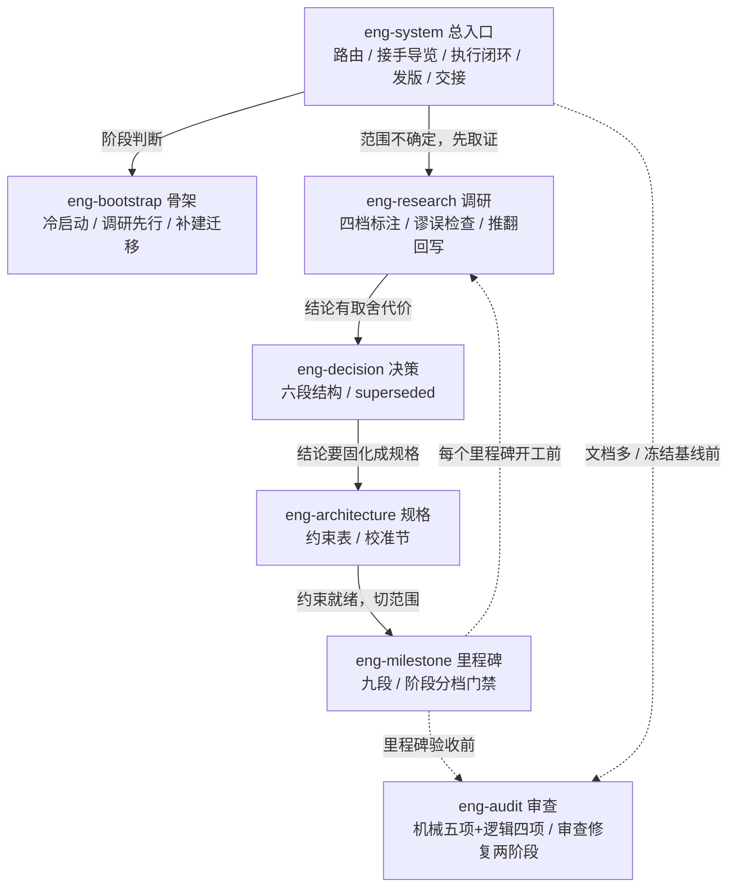

# eng-system · 总入口

先回答一个问题：**你现在处在哪个阶段？** 再决定用哪个技能。

> 本技能不产出文档，只做路由与收尾；产文档的动作在其余 6 个技能里。每个技能都可以单独触发，不必走完整流程。

---

## 一、体系全景



> 实线是主路径，虚线是回路；箭头表示「产物被下游引用」，不代表必须串行。

**产物引用链**：调研（证据）→ 决策（取舍）→ 架构（规格）→ 里程碑（交付）→ 审查（校对）。缺任何一环，追溯都会断。

---

## 二、子技能调用倾向

| 技能 | 什么时候优先调 | 输入（缺则先补上游） | 产物 |
|---|---|---|---|
| `eng-bootstrap` | 新项目起步；文档散乱要收敛；调研完要定稿骨架 | 用户能答「明确不做什么」与栈约束——答不上 → 先 `eng-research` | 五个顶层文件 + docs 五目录 |
| `eng-research` | 核实外部能力/开源项目；里程碑开工前取证；结论被推翻要回写 | 具体断言清单（泛问会得到资料汇编） | 带四档标注的调研报告 |
| `eng-decision` | 选型有取舍代价；要推翻既有结论 | 选项、约束、代价 | `D<N>` 决策文件 |
| `eng-architecture` | 多模块要统一约束；里程碑需要可引用的 `C<NN>` | 调研结论 + 决策 | `A<N>` 规格文档 |
| `eng-milestone` | 范围要切成可独立验收的段 | 架构的 `C<NN>`——缺则先 `eng-architecture` | `M<NN>` 里程碑文档 |
| `eng-audit` | 文档 ≥10 份；冻结基线前；推翻回写之后 | 全库文档 | `R<N>` 审查报告 |

---

## 三、阶段判断

| 你的处境 | 用哪个技能 |
|---|---|
| 刚接手一个陌生项目，想知道从哪读 | §四 接手导览 |
| 要从零起一个项目 | `eng-bootstrap`（先看 §六 选路径） |
| 项目已有一堆文档，想补建规范 | `eng-bootstrap` 的「补建/迁移」 |
| 有了调研，要把结论固化成规格 | `eng-architecture` |
| 要把范围切成可交付的几段 | `eng-milestone` |
| 要核实某个外部能力 | `eng-research` |
| 要做取舍 / 推翻旧决定 | `eng-decision` |
| 文档多了要校对 / 准备冻结 | `eng-audit` |
| 已开工，想知道每轮怎么收尾 | §八 执行闭环 |
| 要交接给下一个会话 | §十 交接清单 |

---

## 四、接手导览（读什么、按什么顺序）

```
1. AGENTS.md      → 不可违反的规约（先读，避免一上手就违规）
2. ROADMAP.md     → 现在在哪个里程碑、什么版本、哪些决策已定
3. 当前里程碑文档 → 目标 / 非目标 / 前置调研 / 交付物 / 门禁
4. 相关架构文档   → 只读与任务相关的章节，不要通读
5. 相关调研       → 只在「为什么这么定」有疑问时读
```

| 想知道的 | 去哪找 |
|---|---|
| 什么**不能**做 | `AGENTS.md` 的「明确不做的事」 |
| 什么**已经定了** | `ROADMAP.md` 的决策索引 |
| 什么**还没定** | 里程碑的「风险与未决」+ 调研的「待确认」 |

**判据**：这五样缺任何一样 → 项目没 bootstrap 完整，转 `eng-bootstrap` 的「补建/迁移」，不要凭空开工。

---

## 五、两条合法路径（不是一条）

| 路径 | 适用 | 顺序 |
|---|---|---|
| **A 骨架先行** | 范围清楚、技术栈确定、需求不再大改 | `eng-bootstrap` → `eng-milestone` →（每个里程碑前）`eng-research` → `eng-audit` |
| **B 调研先行** | 范围本身不确定 / 可行性未知 | 最小目录 → `eng-research` ×N → `eng-decision` → `eng-architecture` → `eng-bootstrap`（定稿）→ `eng-milestone` |

- 路径 A 风险：能力边界靠猜；猜错则返工落在 ROADMAP/AGENTS 全部下游
- 路径 B 关键：先只建 `docs/research/` 与 `_refs/`，**不要在边界没搞清时写死 AGENTS**

**判据**：答不上「明确不做什么」和「技术栈约束」→ 走 B。

---

## 六、轻量分档（不要对小事用重流程）

| 项目规模 | 必做 | 可跳过 |
|---|---|---|
| 一次性脚本 / 单文件 | `eng-decision` 记一行；调研带标注 | 骨架、里程碑、audit、覆盖率 |
| 小工具（≤3 里程碑） | 骨架（简化版）+ 里程碑九段（数据模型/故障注入可标 N/A） | audit 冻结、架构规格（单一模块时） |
| 完整体系（≥4 里程碑 / 多人 / 长期维护） | 全部 7 个技能 | — |

三条「可以不做」的明示：

- **每个技能都可以单独触发**——只用 `eng-research` 也成立，产物就是一份带标注的 md，不需要建齐五个 docs 子目录
- **覆盖率门禁只在进入编码阶段后生效**，文档阶段一律标 `N/A`，不写「待达标」
- **架构规格在单一模块小项目可省**；一旦出现跨模块约束，必须单独成文

---

## 七、执行闭环（开工之后每轮做什么）

最容易漏掉的一半：**开工前写得很好，开工后没人管**。每完成一个可交付单元，按顺序五件事：

```
1. 测试     跑该单元对应的测试；不达标不提交
2. 文档     若行为变化 → 更新对应架构章节（追加「校准」节，不重写）
3. CHANGELOG 只记用户可感知的变化；重构/注释/测试不记
4. 版本     z 位 +1（同一里程碑内）；跨里程碑才动 y
5. ROADMAP  更新该里程碑状态行（⏳ → 🔄 → ✅）
```

## 八、里程碑验收与发版

里程碑完成时，**由执行者主动发起**验收，不等别人来问：

```
1. 逐条打勾验收门禁；不达标项写明原因与补偿措施
2. 填「验收记录」：实际覆盖率、未达标项、遗留技术债
3. 打 x.y.0 tag
4. ROADMAP 状态改 ✅，CHANGELOG 从 [Unreleased] 切到 [x.y.0]
5. 若本里程碑推翻了任何既有结论 → 走 `eng-research` 的「推翻与回写」清单
```

发版五步：

```
1. 从 CHANGELOG 的 [Unreleased] 切出本次范围
2. 建 [x.y.z] - YYYY-MM-DD 段落
3. 破坏性变更单列 ### 破坏性变更 并写迁移方式
4. git tag vx.y.z
5. 确认 ROADMAP 的版本区间与本版本一致
```

**判据**：版本号必须能在 ROADMAP 里找到归属的里程碑；找不到，说明不是「版本」而是「随手改」。

---

## 九、交付汇报格式（每个技能都该用）

技能执行完，回给用户的话必须含三部分，缺一不可：

```
1. 做了什么   —— 产出了哪些文件（给路径）
2. 没做什么   —— 做了但没通过的、跳过的、以及为什么
3. 下一步     —— 建议用哪个技能 / 需要用户拍板什么
```

**只报「已完成」不报「没做到什么」，等于隐藏风险。**

---

## 十、交接清单（会话结束 / 换人时）

```
[ ] 当前里程碑状态行已更新（做到哪一步、下一步是什么）
[ ] 本轮新结论已挂到对应索引（调研/决策/架构章节）
[ ] 本轮推翻的旧结论，已按「推翻与回写」清单改完所有受影响文件
[ ] 未完成的工作写清「卡在哪、需要谁做什么」
[ ] 下一轮的第一件事（一句话）
```

**不要用「进度正常」这类话交接。** 接手者要的是「下一步做什么」和「哪里有坑」。

---

## 十一、反模式

| 反模式 | 后果 |
|---|---|
| 跳过阶段判断，直接动手 | 在错的阶段用错的技能，产物要重做 |
| 对 200 行脚本用全套流程 | 仪式成本高于收益，最后没人真执行 |
| 交接只写「进度正常」 | 接手者不知道下一步做什么、哪里有坑 |
| 只报「已完成」不报「没做到」 | 隐藏风险，下次在同一个坑里再摔 |
| 能力和约束没想清就写 AGENTS | 骨架返工，连累全部下游 |
| 把技能当流水线强制串行 | 技能可单独用；强拼成一条线会卡在不适用的环节 |

---

## 十二、自检

```
[ ] 已判断当前阶段，并选定了对应技能
[ ] 若范围不确定，走的是「调研先行」而不是硬写骨架
[ ] 按规模选了对等的档位，没对小事用重流程
[ ] 交付汇报含「做了什么 / 没做什么 / 下一步」三段
[ ] 若在交接：五条清单已写完，且写了下一轮第一件事
```
