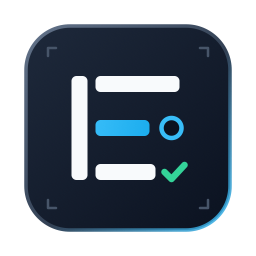

> ⚠️ **This directory is a build artifact** (generated by `scripts/build.sh` from `packages/eng-system/`).
> Do not edit directly; change the source files and rebuild instead.

<div align="center">



# eng-system

**Engineering Documentation Skill Suite · Process Hardened into Falsifiable Gates**

[](https://github.com/TidaltoLabs/tidalto-plugins/blob/main/packages/eng-system/VERSION)
[](https://agent-plugins.org/schemas/1.0.0/plugin.schema.json)
[](https://antigravity.google/schemas/v1/plugin.json)
[](#the-skills)
[](LICENSE)

[简体中文](README.md) · English &nbsp;|&nbsp; [Installation](#installation) · [The Skills](#the-skills) · [Usage](#usage) · [Changelog](https://github.com/TidaltoLabs/tidalto-plugins/blob/main/packages/eng-system/CHANGELOG.md)

</div>

---

A reusable **engineering documentation system** packaged as Agent Skills: 7 skills that harden "onboarding / skeleton / research / decisions / architecture / milestones / audits" into gated process constraints. One content source, built out to Claude Code, Codex CLI, ZCode, Cursor / Copilot, Antigravity, DSH and other hosts.

> It is not a project-management template — it is **process constraints**, solving the problem of "documents that get written but never honored."

---

## Why you need it

Project documentation usually dies in one of three ways:

1. **No gates** — "finish the research before coding" stays a slogan; in practice you write and change course at the same time
2. **Conclusions drift** — the same fact has different versions across documents, and nobody knows which one is current
3. **History is lost** — decisions live only in chat; once the context gets compacted, they are gone

Templates cannot fix these: a template answers "what should the document look like," not "when must it exist and what happens if it is substandard." This suite hardens process into **falsifiable criteria** — every skill defines "what counts as done" and "what fails the gate," with anti-pattern tables and checkable self-review lists.

The 7 skills map onto the three failure modes. Lost history is countered by `eng-decision`'s audit trail with its superseded mechanism, and `eng-research`'s multi-round revision trail. Drifting conclusions are countered by `eng-architecture`'s frozen constraints with calibration sections, and `eng-audit`'s whole-repo consistency review. Missing gates are countered by `eng-bootstrap`'s acceptance gates and `eng-milestone`'s ready-to-code / done criteria. The `eng-system` entry skill decides which one to use when.

---

## The skills

| Skill | What it solves | Core output |
|---|---|---|
| `eng-system` | **Entry point**: onboarding tours, phase detection, right-sizing, execution loop, releases, handoff | Routing (produces no documents) |
| `eng-bootstrap` | Build the skeleton (three entries: cold start / research-first / retrofit) | Five top-level files + five docs directories |
| `eng-research` | What makes research good enough to act on (not a link dump) | Four-tier source grading + five fallacy types + **refutation write-back list** |
| `eng-decision` | How to record decisions, when to split them out, how to leave a trail after reversals | Six-part structure + superseded mechanism |
| `eng-architecture` | Freeze conclusions into constraints and interfaces others can cite | Constraint table (objective / engineering) + calibration section |
| `eng-milestone` | How to slice milestones, what qualifies as ready-to-code, what counts as done | Nine-part structure + **phase-tiered gates** |
| `eng-audit` | Consistency review once documents multiply | Five mechanical checks + four logical checks + **two-phase review/fix** |

Every skill follows the same writing discipline: one sentence on what problem it solves, falsifiable criteria, an anti-pattern table (wrong way + consequence + right way), and a checkable self-review list. Some skills ship **optional mechanical scripts** (bash + POSIX tools, no network; the skill body always documents the equivalent manual method, so skills remain fully usable without a shell). Contribution rules live in [AGENTS.md](AGENTS.md) (Chinese).

---

## Usage

### Two legal paths (not one)

| Path | When | Order |
|---|---|---|
| **Skeleton first** | Scope clear, stack decided | `bootstrap` → `milestone` → `research` → `audit` |
| **Research first** | Scope uncertain / feasibility unknown | minimal directories → `research` ×N → `decision` → `architecture` → `bootstrap` (finalize) → `milestone` |

Criterion: **if you cannot answer "what are we explicitly NOT doing" and "what are the stack constraints," go research-first.**

### Right-sizing (no heavy process for small work)

| Scale | Required | Skippable |
|---|---|---|
| One-off script / single file | one-line `decision` + graded research | skeleton, milestones, audit |
| Small tool (≤3 milestones) | simplified skeleton + nine-part milestone (data model / fault injection may be N/A) | audit freeze, architecture spec |
| Full system (≥4 milestones / long-lived) | all 7 skills | — |

### Every skill works standalone

You don't need the whole process to use one skill. `eng-research` alone is fine — the output is a graded research md, no five docs directories required. When lost, start at the `eng-system` entry skill and let it detect the phase for you.

---

## Installation

### As a marketplace source

This plugin is distributed via the **TidaltoLabs/tidalto-plugins** marketplace repository.

| Tool | Marketplace manifest | How to install |
|---|---|---|
| **Claude Code** | `.claude-plugin/marketplace.json` | `claude plugin marketplace add TidaltoLabs/tidalto-plugins` → `claude plugin install eng-system@tidalto-plugins` (`/plugin ...` works in-session too) |
| **Codex CLI** | `.agents/plugins/marketplace.json` | `codex plugin marketplace add TidaltoLabs/tidalto-plugins` → `codex plugin add eng-system@tidalto-plugins` |
| **ZCode** | `.claude-plugin/marketplace.json` (preferred) & root `marketplace.json` | Plugin Marketplace → Add → Add plugin marketplace → enter `TidaltoLabs/tidalto-plugins` (**UI only, no CLI**) |
| **Cursor / Copilot** | same as Codex (Agent Plugins 1.0) | add `TidaltoLabs/tidalto-plugins` in the plugin panel |
| **Antigravity** | not on a marketplace yet | CLI install from GitHub subdir: `agy plugin install https://github.com/TidaltoLabs/tidalto-plugins/tree/main/plugins/eng-system/antigravity` (syncs automatically to App / IDE; or copy `plugins/eng-system/antigravity/` to `~/.gemini/config/plugins/eng-system/` or a project's `.agents/plugins/eng-system/`) |
| **DSH** | not on a marketplace yet | bundle install: `dsh plugin --profile web add "git+https://github.com/TidaltoLabs/tidalto-plugins.git#main&path:plugins/eng-system/dsh"` (or a local repo path); zero-install in [adapters/dsh/README.md](adapters/dsh/README.md) |

> Each manifest points at its host directory: Claude → `plugins/eng-system/claude/`, Codex/Cursor/Copilot → `plugins/eng-system/agent-plugins/`, ZCode → `plugins/eng-system/zcode/`. Antigravity installs directly from `plugins/eng-system/antigravity/` (**do not pass the bare repo root URL**, or `agy` bulk-scans `plugins/`).

> **Update mechanics differ per host**: Claude Code, ZCode, Codex, and DSH all track updates via SemVer (bumped together with root `VERSION`); Antigravity GitHub URL installs are one-shot clones and do not auto-check upstream — re-run `agy plugin install` to update (your enabled/disabled toggle is preserved); until a DSH marketplace listing exists, pin a commit or branch when installing via git.

### Zero install (no plugin)

For using the skills without installing a plugin:

```bash
# skills
mkdir -p ~/.agents/skills
cp -R plugins/dsh/skills/* ~/.agents/skills/

# templates must sit two levels above the skills dir, or ../../templates won't resolve
mkdir -p ~/.agents/templates
cp -R templates/* ~/.agents/templates/
```

> The same `~/.agents/skills/` directory is read by **Codex / Cursor / Copilot / Gemini CLI / DSH**.

---

## Repository layout

```
eng-system/
├── README.md            # Chinese readme
├── README_EN.md         # this file
├── AGENTS.md            # contributor guide (Chinese)
├── CHANGELOG.md
├── LICENSE              # MIT
├── VERSION              # single source of the version number
├── skills/              # the only hand-written content (Agent Skills format, 7 skills + optional scripts)
│   ├── eng-system/SKILL.md        # entry: routing / onboarding / execution / release / handoff
│   ├── eng-bootstrap/SKILL.md
│   ├── eng-research/SKILL.md
│   ├── eng-decision/SKILL.md
│   ├── eng-architecture/SKILL.md
│   ├── eng-milestone/SKILL.md
│   └── eng-audit/SKILL.md
├── templates/           # 13 scaffold templates (incl. architecture / review / gitignore / three directory indexes)
├── logos/               # project & plugin logo assets (logo.svg + 512/256/128 transparent PNGs, shared by README and host manifests)
├── adapters/            # per-platform manifests & adaptation only (no content)
│   ├── agent-plugins/plugin.json
│   ├── antigravity/plugin.json
│   ├── claude/.claude-plugin/plugin.json
│   ├── zcode/.zcode-plugin/plugin.json
│   └── dsh/             # DSH adaptation: bundle shell sources + install guide
│       ├── bundle/      # package.json + cordis.patch.yml + index.js (the provider)
│       └── README.md
├── plugins/             # build artifacts (committed; marketplace manifests point here)
│   ├── agent-plugins/   # Codex / Cursor / Copilot
│   ├── antigravity/     # Google Antigravity (App / CLI / IDE)
│   ├── claude/
│   ├── zcode/
│   └── dsh/             # installable DSH bundle (eng-system-dsh) + zero-install payload
├── .claude-plugin/marketplace.json    # Claude marketplace manifest
├── .agents/plugins/marketplace.json   # Codex marketplace manifest
└── scripts/build.sh     # generates plugins/ + self-checks
```

**Design rule: content lives once (`skills/` + `templates/`); adapters hold manifests only.**

`plugins/` keeps one complete plugin root per host instead of sharing a single copy. Reason: when one directory contains both a root `plugin.json` and `.claude-plugin/plugin.json`, Codex/Copilot interpret the root manifest as Agent Plugins and ignore Claude-specific components. Content still lives once — everything under `plugins/` is generated by `scripts/build.sh` from `skills/` + `templates/`, and each artifact README carries a "build artifact, do not edit" banner.

---

## Design tradeoffs

| Tradeoff | Why |
|---|---|
| Templates external, not inline | Templates are big and evolve with projects; external keeps a single point of edit. Cost: relative paths must resolve |
| Seven skills, not one | Trigger scenarios differ; merging blurs descriptions and breaks auto-triggering |
| No language/framework binding | The constraints are language-agnostic; binding would limit reuse |
| No project-specific conclusion docs | Those are project assets, not system content |
| Coverage numbers only in AGENTS | Numbers repeated in many places always drift; everything else says "AGENTS is authoritative" |
| Review and fix are two phases | Fixing while reviewing introduces new contradictions and blurs old vs new issues |
| One content source, many manifests | Skills are the universal layer; marketplace manifests speak per-host dialects |

---

## Where this comes from

Distilled from a real project's path from zero to "ready to code": 9 rounds of research, 3 architecture specs, 7 milestones, 2 decision records, and one whole-repo consistency audit (6 blocking + 19 advisory findings).

The anti-patterns and pitfalls in these skills were all actually stepped in — none are hypothetical.

---

Current version **v0.3.4** (single source: [VERSION](VERSION)) · Chinese readme: [README.md](README.md) · License: MIT
