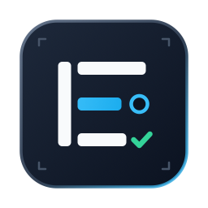

> ⚠️ **本目录是构建产物**（由 `scripts/build.sh` 从 `packages/eng-system/` 生成）。
> 请勿直接修改；改动请改源文件后重新构建。

<div align="center">



# eng-system

**工程文档体系技能组 · 把流程固化成可判真伪的门禁**

[](https://github.com/TidaltoLabs/tidalto-plugins/blob/main/packages/eng-system/VERSION)
[](https://agent-plugins.org/schemas/1.0.0/plugin.schema.json)
[](https://antigravity.google/schemas/v1/plugin.json)
[](#技能一览)
[](LICENSE)

简体中文 · [English](README_EN.md) &nbsp;|&nbsp; [安装](#安装) · [技能一览](#技能一览) · [怎么用](#怎么用) · [变更记录](https://github.com/TidaltoLabs/tidalto-plugins/blob/main/packages/eng-system/CHANGELOG.md)

</div>

---

一套可跨项目复用的**工程文档体系**技能组：7 个 Agent Skills，把「接手 / 骨架 / 调研 / 决策 / 架构 / 里程碑 / 审查」固化成带门禁的流程约束。内容只有一份，构建到 Claude Code、Codex CLI、ZCode、Cursor / Copilot、Antigravity、DSH 等多类宿主。

> 它不是项目管理模板，而是**流程约束**——解决的是"文档写了但没人守"的问题。

---

## 为什么需要它

项目文档通常死于三件事：

1. **没有门禁**——「调研做完再开工」只是口号，实际是边写边改
2. **结论会漂**——同一件事在多份文档里有多种说法，没人知道哪个是最新
3. **历史会丢**——决策只存在对话里，上下文一压缩就没了

模板救不了这三件事：模板只回答「文档长什么样」，不回答「什么时候必须写、写得不合格会怎样」。这套技能的做法是把流程固化成**可判真伪的判据**——每个技能都定义「什么算合格」「什么不能通过」，并配套反模式表与可勾选的自检清单。

7 个技能正对着这三个死法：「历史会丢」由 `eng-decision` 的留痕与 superseded 机制、`eng-research` 的多轮修订留痕来治；「结论会漂」由 `eng-architecture` 的约束固化与校准节、`eng-audit` 的全库校对来治；「没有门禁」由 `eng-bootstrap` 的验收门禁、`eng-milestone` 的开工/通过判据来治。`eng-system` 总入口负责判断当前该用哪个。

---

## 技能一览

| 技能 | 解决什么 | 核心产物 |
|---|---|---|
| `eng-system` | **总入口**：接手导览、阶段判断、轻量分档、执行闭环、发版、交接 | 路由（不产出文档） |
| `eng-bootstrap` | 建骨架（三种入口：冷启动 / 调研先行 / 补建迁移） | 五个顶层文件 + docs 五目录 |
| `eng-research` | 调研怎么写才算合格（而非资料汇编） | 四档标注 + 五类谬误 + **推翻回写清单** |
| `eng-decision` | 决策怎么记、何时独立成文、推翻后怎么留痕 | 六段结构 + superseded 机制 |
| `eng-architecture` | 把结论固化成可被引用的约束与接口 | 约束表（客观/工程）+ 校准节 |
| `eng-milestone` | 里程碑怎么切、什么算能开工、什么算通过 | 九段结构 + **阶段分档门禁** |
| `eng-audit` | 文档变多后的一致性校对 | 机械五项 + 逻辑四项 + **审查/修复两阶段** |

每个技能的正文遵循同一套写法：一句话说明解决什么问题、可判真伪的判据、反模式表（错法 + 后果 + 正确做法）、可勾选的自检清单。部分技能附**可选机械化脚本**（bash + POSIX 工具、无网络；正文含等价人工手法，无脚本环境技能完整可用）。写作与贡献规约见 [AGENTS.md](AGENTS.md)。

---

## 怎么用

### 两条合法路径（不是一条）

| 路径 | 适用 | 顺序 |
|---|---|---|
| **骨架先行** | 范围清楚、技术栈确定 | `bootstrap` → `milestone` → `research` → `audit` |
| **调研先行** | 范围不确定 / 可行性未知 | 最小目录 → `research` ×N → `decision` → `architecture` → `bootstrap`（定稿）→ `milestone` |

判据：**答不上「明确不做什么」和「技术栈约束」时，走调研先行。**

### 轻量分档（不要对小事用重流程）

| 规模 | 必做 | 可跳过 |
|---|---|---|
| 一次性脚本 / 单文件 | `decision` 记一行 + 调研带标注 | 骨架、里程碑、audit |
| 小工具（≤3 里程碑） | 简化骨架 + 里程碑九段（数据模型/故障注入可标 N/A） | audit 冻结、架构规格 |
| 完整体系（≥4 里程碑 / 长期维护） | 全部 7 个技能 | — |

### 每个技能都可以单独触发

不必为了用一个技能而装下整套流程。只用 `eng-research` 也成立——产物就是一份带四档标注的 md，不需要建五个 docs 子目录。「不知道从哪开始」时，从总入口 `eng-system` 进入，由它判断当前阶段该做什么。

---

## 安装

### 作为市场源安装

本插件收录在 **TidaltoLabs/tidalto-plugins** 官方插件市场中。各工具只需识别市场仓库地址即可安装。

| 工具 | 市场清单 | 安装方式 |
|---|---|---|
| **Claude Code** | `.claude-plugin/marketplace.json` | `claude plugin marketplace add TidaltoLabs/tidalto-plugins` → `claude plugin install eng-system@tidalto-plugins`（会话内用 `/plugin ...` 同样可用） |
| **Codex CLI** | `.agents/plugins/marketplace.json` | `codex plugin marketplace add TidaltoLabs/tidalto-plugins` → `codex plugin add eng-system@tidalto-plugins` |
| **ZCode** | `.claude-plugin/marketplace.json`（优先）与根 `marketplace.json` | 插件市场 → 添加 → 添加插件市场 → 填 `TidaltoLabs/tidalto-plugins`（**仅 UI 入口，无 CLI**） |
| **Cursor / Copilot** | 同 Codex（Agent Plugins 1.0） | 插件面板添加 `TidaltoLabs/tidalto-plugins` |
| **Antigravity** | 暂未上架市场 | CLI 从 GitHub 子目录安装：`agy plugin install https://github.com/TidaltoLabs/tidalto-plugins/tree/main/plugins/eng-system/antigravity`（安装后 App / IDE 自动同步；也可复制 `plugins/eng-system/antigravity/` 到 `~/.gemini/config/plugins/eng-system/` 或业务项目 `.agents/plugins/eng-system/`） |
| **DSH** | 暂未上架市场 | bundle 安装：`dsh plugin --profile web add "git+https://github.com/TidaltoLabs/tidalto-plugins.git#main&path:plugins/eng-system/dsh"`（或本地仓库路径）；零安装见 [adapters/dsh/README.md](adapters/dsh/README.md) |

> 各清单指向对应宿主目录：Claude → `plugins/eng-system/claude/`，Codex/Cursor/Copilot → `plugins/eng-system/agent-plugins/`，ZCode → `plugins/eng-system/zcode/`；Antigravity 直接指向 `plugins/eng-system/antigravity/`（**不要传仓库根 URL**，否则 `agy` 会触发 `plugins/` 批量扫描）。

> **更新机制因宿主而异**：Claude Code / ZCode / Codex / DSH 均统一按 SemVer 版本号更新（随根 `VERSION` 升号）；Antigravity 的 GitHub URL 安装为一次性 clone 落盘，不会自动检查远端更新，升级需重新执行一次 `agy plugin install`（覆盖安装，保留启用/禁用状态）；DSH 市场收录前用 git 安装请固定 commit 或分支。

### 零安装（不装插件）

适合只想用技能、不想装插件的场景：

```bash
# 技能
mkdir -p ~/.agents/skills
cp -R plugins/dsh/skills/* ~/.agents/skills/

# 模板必须放到技能目录的上两级，否则 ../../templates 解析失败
mkdir -p ~/.agents/templates
cp -R templates/* ~/.agents/templates/
```

> 同一份 `~/.agents/skills/` 会被 **Codex / Cursor / Copilot / Gemini CLI / DSH** 读取。

---

## 仓库结构

```
eng-system/
├── README.md
├── README_EN.md         # 英文版 README（产物双语源之一）
├── AGENTS.md            # 贡献者规约
├── CHANGELOG.md
├── LICENSE              # MIT
├── VERSION              # 版本号单一来源
├── skills/              # 唯一手写内容源（Agent Skills 格式，7 个技能 + 可选机械脚本）
│   ├── eng-system/SKILL.md        # 总入口：路由 / 接手 / 执行 / 发版 / 交接
│   ├── eng-bootstrap/SKILL.md
│   ├── eng-research/SKILL.md
│   ├── eng-decision/SKILL.md
│   ├── eng-architecture/SKILL.md
│   ├── eng-milestone/SKILL.md
│   └── eng-audit/SKILL.md
├── templates/           # 13 份脚手架模板（含 architecture / review / gitignore / 三份目录索引）
├── logos/               # 项目与插件图标素材（logo.svg + 512/256/128 透明底 PNG，供 README 与各宿主清单复用）
├── adapters/            # 各平台清单与适配（只放清单与适配层，不放内容）
│   ├── agent-plugins/plugin.json
│   ├── antigravity/plugin.json
│   ├── claude/.claude-plugin/plugin.json
│   ├── zcode/.zcode-plugin/plugin.json
│   └── dsh/             # DSH 适配：bundle 薄壳源 + 安装说明
│       ├── bundle/      # package.json + cordis.patch.yml + index.js（provider）
│       └── README.md
├── plugins/             # 构建产物（入库，供市场清单指向）
│   ├── agent-plugins/   # Codex / Cursor / Copilot
│   ├── antigravity/     # Google Antigravity（App / CLI / IDE）
│   ├── claude/
│   ├── zcode/
│   └── dsh/             # 可安装 DSH bundle（eng-system-dsh）+ 零安装载荷
├── .claude-plugin/marketplace.json    # Claude 市场清单
├── .agents/plugins/marketplace.json   # Codex 市场清单
└── scripts/build.sh     # 生成 plugins/ + 自检
```

**设计原则：内容只有一份（`skills/` + `templates/`），适配层只放清单。**

`plugins/` 下每个宿主一个完整插件根，而不是共用一份。原因：若同一目录同时存在根 `plugin.json` 与 `.claude-plugin/plugin.json`，Codex/Copilot 会把根清单当 Agent Plugins 解释，忽略 Claude 专属组件。内容仍然只有一份——`plugins/` 全部由 `scripts/build.sh` 从 `skills/` + `templates/` 生成，产物 README 顶部带「生成物勿手改」横幅。

---

## 设计取舍

| 取舍 | 原因 |
|---|---|
| 模板外置而非内联 | 模板体积大、会随项目演进；外置便于单点修改。代价：依赖相对路径可解析 |
| 七个技能而非一个大技能 | 触发场景差异大；合并会导致 description 模糊、自动触发失准 |
| 不绑定具体语言/框架 | 这套约束与语言无关，绑定会限制复用 |
| 不含具体项目的结论文档 | 那是项目专属资产，不属于体系 |
| 覆盖率只在 AGENTS 写数字 | 数字分散多处必然漂移；其余文档一律写「以 AGENTS 为准」 |
| 审查与修复分两个阶段 | 边审边改会引入新矛盾，且无法区分原问题与新问题 |
| 一套内容、多份清单 | 技能层是通用标准，市场清单层各家方言，无法合并 |

---

## 这套体系从哪来

提炼自一个真实项目从零到"可开工"的全过程：9 轮调研、3 份架构规格、7 个里程碑、2 份决策记录、一次全库校对（发现 6 个阻断级 + 19 个建议级问题）。

技能里那些"反模式"和"实际踩过的坑"，都是真踩过的，不是想象中的。

---

当前版本 **v0.3.4**（单一来源：[VERSION](VERSION)）· 变更历史见 [CHANGELOG.md](CHANGELOG.md) · License: MIT
